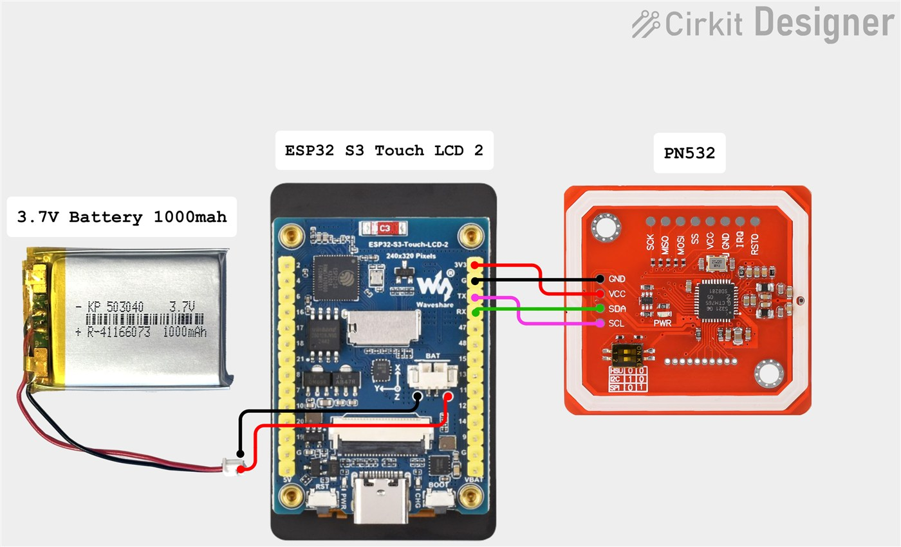

<p align="center">
  <picture>
    <source media="(prefers-color-scheme: dark)"  srcset="assets/logo-tigertag-head-dark.svg">
    <source media="(prefers-color-scheme: light)" srcset="assets/logo-tigertag-head.svg">
    
  </picture>
</p>

<h1 align="center">TigerSpool RFID</h1>

<p align="center">
  <strong>Tap a spool on the box. The filament lands in the right printer slot.</strong><br>
  A 2.0" touchscreen, a PN532 reader, and no typing.
</p>

<p align="center">
  
  
  
  
  
</p>

<p align="center">
  <a href="https://tigertag-project.github.io/TigerSpool-RFID/">
    
  </a>
</p>

<p align="center">
  <a href="#what-it-is">What it is</a>
  &nbsp;&middot;&nbsp;
  <a href="#the-case-a-desktop-stand-or-built-into-your-printer">Print the case</a>
  &nbsp;&middot;&nbsp;
  <a href="#before-you-start">Before you start</a>
  &nbsp;&middot;&nbsp;
  <a href="#quick-start">Quick start</a>
  &nbsp;&middot;&nbsp;
  <a href="#build-it-yourself">Build one</a>
</p>

<p align="center">
  
</p>

---

**TigerSpool RFID** is open-source firmware for a small box that sits next to
your 3D printer. Hold a spool carrying a TigerTag NFC chip against it, pick a
slot on the touchscreen, and the box writes the filament into that slot on the
printer — material, brand, colour and temperatures. No app, no keyboard, no
retyping what the tag already knows.

MIT licensed. Built with PlatformIO for the ESP32-S3.

---

## What it is

Your printer already has a slot list. Your filament already carries its own
identity. TigerSpool is the thirty centimetres between them.

<p align="center">
  
  
  
</p>

<p align="center">
  <sub>1. Tap a slot · 2. Hold the spool against the box · 3. Sent - load it where the box says.</sub>
</p>

- **Tap a slot, present the spool, done.** There is nothing to confirm: the
  assignment leaves for the printer as soon as the tag is read, over the
  printer's own protocol, and the box tells you which slot to load.
- **Scan mode: what is this spool?** Put one on the reader and the box shows
  what the chip holds - colour, material, brand, the two temperature windows,
  the drying instruction, what is left on it, and whether the tag is certified.
  No printer involved.
- **Your printers come from your account.** They are configured once, in Tiger
  Studio Manager, and every TigerSpool you own reads the same list.
- **It speaks eleven languages** - English, French, German, Spanish, Italian,
  Polish, both Portuguese, Chinese, Russian and Dutch - and asks which one before
  anything else.
- **It updates itself.** Over the air, verified, from this repository's releases.

## The case: a desktop stand, or built into your printer

**The desktop stand is TigerSpool.** It stands beside any printer, holds the
spool against the reader while you tap, and is the one to print if you are not
sure. It comes in two mirrored versions, the spool on the left of the screen or
on the right. No screws, no inserts: it is 100 % printed, and it prints without
supports.

<div align="center">

| Spool on the left | Spool on the right |
|---|---|
|  |  |
| **[Print it from MakerWorld](https://makerworld.com/models/3360492-tigerspool-desktop-stand-spool-on-the-left)** · [files](Model3D/0.Desktop/) | **[Print it from MakerWorld](https://makerworld.com/models/3360619-tigerspool-desktop-stand-spool-on-the-right)** · [files](Model3D/0.Desktop/) |

</div>

**The printer integrations** are the same TigerSpool - same board, same reader,
same firmware - in a shell that clips onto a printer's own screen, so the box
lives where the spools are loaded.

<div align="center">

| Printer | | Print it |
|---|---|---|
| **Creality K2**<br>**Creality K2 Pro** |  | **[MakerWorld](https://makerworld.com/models/3361291-tigerspool-for-creality-k2-and-k2-pro)** · [files](Model3D/2.Creality/K2-K2Pro/) |
| **FlashForge Creator 5**<br>**FlashForge Creator 5 Pro** |  | **[MakerWorld](https://makerworld.com/models/3361301-tigerspool-rfid-for-flashforge-creator-5-and-5-pro)** · [files](Model3D/4.FlashForge/Creator5-5Pro/)<br><br>**[Firmware "FlashForge × TigerTag"](https://tigertag-project.github.io/FlashForge-TigerTag-Creator5-Firmware-Lan-and-Cloud/download/creator5/)**<br>LAN + Cloud<br>Recommended |
| **Bambu Lab A1**<br>**Bambu Lab A2L** |  | [files](Model3D/1.BambuLab/A1-A2/) - not on MakerWorld yet |
| **Anycubic Kobra 3**<br>**Anycubic Kobra 3 V2**<br>**Anycubic Kobra 3 Max**<br>**Anycubic Kobra 3 Max V2** |  | [files](Model3D/6.Anycubic/Kobra3-Series/) - not on MakerWorld yet |

</div>

Every model, its print settings and how to add one: **[Model3D/](Model3D/)**.

## Before you start

**This is the part that catches people out, so it is first.**

A TigerSpool has no keyboard and no way to type a printer's address, and that is
deliberate — it reads your printers from your TigerTag account instead. Which
means two things have to exist before the box is useful:

### 1. A TigerTag account, created in Tiger Studio Manager

**[Tiger Studio Manager](https://github.com/TigerTag-Project/TigerTag-Studio-Manager)**
is the desktop application for the ecosystem. Install it and create an account
there. That account is what the TigerSpool signs in to — by e-mail, or with
Google through a QR code, so you never type a password on a 2" screen.

Without an account, the box gets through Wi-Fi setup and then has nothing to
sign in to.

<p align="center">
  
</p>

<p align="center">
  <sub>The TigerTag system: one account, shared by Tiger Studio Manager, the
  TigerTag app and every device - TigerSpool included.</sub>
</p>

### 2. Your printers, added in Tiger Studio Manager

Adding a printer means Tiger Studio finds it on your network, or you enter its
address and access code, and stores it against your account.

**If you have not done this, the printer list on the box will be empty.** That is
not a fault and there is nothing to fix on the device — it is showing you exactly
what your account contains. Add the printer in Tiger Studio, and it appears on
the box at the next sync.

The same is true for the details: the access code, the IP address, the brand and
model all come from there. TigerSpool reads that list; it does not build it.

<p align="center">
  
</p>

<p align="center">
  <sub>Tiger Studio Manager. Your filaments and your printers live here — the box
  reads this list, it does not build it.</sub>
</p>

> **In short:** Tiger Studio Manager → create an account → add your printers →
> *then* set up the box.

## Quick start

### Step 1 — install from your browser

**Plug the board into your computer → click Install → wait a minute.** Use the
button at the top of this page. It writes the bootloader, the partition table,
the boot selector and the firmware.

Chrome, Edge or Opera, on a desktop or laptop. Safari and Firefox do not
implement WebSerial and no mobile browser does — the page says so rather than
failing quietly.

### Step 2 — set it up on the box

1. **Pick your language.** Eleven of them, before anything else.
2. **Join Wi-Fi.** The box shows a QR code. Scan it with your phone, and a page
   opens listing the networks it can see. Pick yours, type the password on your
   phone, and the box joins — no reboot, nothing typed on the small screen.
3. **Sign in.** E-mail and password, or Google through a second QR code.
4. **Your printers arrive.** From your account, as configured in Tiger Studio.
   The box's address on your network (`http://tigerspool-xxxx.local/`) shows
   who is signed in, lists those printers with a switch for each, syncs them
   again, and signs out - all from a phone.

<p align="center">
  
  
  
  
</p>

Then tap the slot you want and hold a tagged spool against the box. It is sent
to the printer as soon as it is read - there is nothing to confirm - and the
box then tells you where to put it.

That last part is the one people miss: **it tells the printer what the spool
is, it does not load it.** Putting the spool in that slot - the CFS, the AMS,
the ACE unit, whatever your printer calls its tray - is still yours to do.

From then on it updates itself over the air.

### Build it yourself

```bash
git clone https://github.com/TigerTag-Project/TigerSpool-RFID.git
cd TigerSpool-RFID

bash scripts/flash.sh --monitor
```

That builds the firmware, flashes it over USB and opens the serial console.
Requires [PlatformIO Core](https://docs.platformio.org/en/latest/core/installation/).

An ordinary flash **keeps your Wi-Fi credentials, your account session and your
printers** — nothing it writes touches the NVS partition. `--erase` wipes the
chip and is how you get a genuine first-boot again.

## Hardware

One board, one reader, four wires. The electronics are identical for every
printer brand — only the 3D-printed shell changes.

<div align="center">

| Qty | Component | Link |
|---|---|---|
| 1 | Waveshare ESP32-S3-Touch-LCD-2 — 240×320 IPS touch, ESP32-S3**R8**, 16 MB flash, 8 MB octal PSRAM. Screen, touch and MCU on one board | [buy](https://link.amazon/B06RoLfDi) |
| 1 | PN532 **V3** NFC module — DIP switches, set to **HSU (UART)**: both switches `0` / OFF, not I²C, not SPI | [buy](https://link.amazon/B0iJgHVtP) |
| 1 | USB-C to USB-A cable **that carries data** — a charge-only cable makes a working board look dead: no serial port ever appears | [buy](https://link.amazon/B00Xg3WT4) |
| — | Four jumper wires — 3V3, GND, TX, RX | ships with the PN532 |
| 1 | 3D-printed case — the desktop stand, or the integration made for your printer ([above](#the-case-a-desktop-stand-or-built-into-your-printer)) | [MakerWorld](https://makerworld.com/@TigerTag) · [Model3D/](Model3D/) |
| *opt.* | Magnetic USB connector — the port is the one part handled every day; the cable lets go instead of the socket | [buy](https://link.amazon/B0bWVIBa0) |
| *opt.* | 3.7 V 1000 mAh LiPo cell, PH1.25 — charged over USB, and the box runs from it with the cable out. Optional: declare it in **Settings › Battery**, since the board cannot detect it. **Check the polarity** | [buy](https://link.amazon/B0fL0jjf3) |

</div>

**About 40 €** in total, plus filament.

> Some of the links above are Amazon affiliate links: buying through them pays
> the project a small commission at no cost to you. Nothing on this list is
> chosen because it is affiliated — any equivalent module works.

Full parts list: **[hardware/BOM.md](hardware/BOM.md)** ·
Wiring: **[docs/WIRING.md](docs/WIRING.md)** and **[hardware/pinout.md](hardware/pinout.md)**

<p align="center">
  <a href="docs/WIRING.md">
    
  </a>
</p>
<p align="center">
  <sub><a href="https://app.cirkitdesigner.com/project/5b546f4e-70b8-4735-afff-be6bd36bc10c">Interactive schematic in Cirkit Designer</a></sub>
</p>

> **The reader goes on GPIO43/44.** Not GPIO6/7 — that pair is an I²C bus with
> pull-ups on this board. A PN532 wired there powers up, answers, and returns
> random UIDs with failing reads. It looks like a bad tag or a bad antenna. It is
> neither, and it costs a day. Follow [docs/WIRING.md](docs/WIRING.md) exactly.

## Printer support

**Every printer Tiger Studio Manager can add works with TigerSpool** - the
models below are that list. The current state of
every brand is in **[docs/PRINTER-COMPATIBILITY.md](docs/PRINTER-COMPATIBILITY.md)**,
which grades each on three levels — ✅ automatic, ⚙️ one setup step,
🧪 experimental. Read it before buying parts for a specific printer.

<div align="center">

| Brand | Firmware support | Transport |
|---|---|---|
| **Creality** | ✅ implemented, proven on hardware | WebSocket |
| **FlashForge** | ✅ implemented, proven on hardware | HTTP |
| **Bambu Lab** | ✅ implemented, proven on hardware - LAN and cloud mode | MQTT over TLS |
| **Snapmaker** | ✅ implemented, proven on hardware | Moonraker over WebSocket |
| **Elegoo** | ✅ implemented, reading proven on hardware | MQTT |
| **Anycubic** | ✅ implemented, proven on hardware - LAN and cloud mode | MQTT over TLS |
| **Klipper** | 🧪 implemented, not yet proven on a printer | Moonraker over WebSocket |

</div>

**How TigerSpool reaches each printer, and what to switch on first.** A
**Combo** is the same printer with its AMS, CFS, ACE or CANVAS attached, and
works the same way.

<div align="center">

| Printer | Mode | What to do on the printer |
|---|:---:|---|
| **Bambu Lab**<br>Bambu Lab A1 mini<br>Bambu Lab A1<br>Bambu Lab A2L<br>Bambu Lab P1P<br>Bambu Lab P1S<br>Bambu Lab P2S<br>Bambu Lab X1C<br>Bambu Lab X1E<br>Bambu Lab X2D<br>Bambu Lab H2D<br>Bambu Lab H2D Pro<br>Bambu Lab H2S<br>Bambu Lab H2C | LAN<br>Cloud, read only | LAN: turn on **LAN mode and Developer mode** on the printer. Cloud: nothing on the printer - the spools are shown, but a tag cannot be written to the slot. |
| **Creality**<br>Creality K1<br>Creality K1C<br>Creality K1 SE<br>Creality K1 Max<br>Creality K2<br>Creality K2 SE<br>Creality K2 Pro<br>Creality K2 Plus<br>Creality Hi<br>Creality Ender-3 V4<br>Creality SparkX i7 | LAN | Nothing: the printer accepts local requests while it stays on Creality Cloud. |
| **FlashForge**<br>FlashForge Creator 5<br>FlashForge Creator 5 Pro | LAN | Either turn **LAN mode** on - which disconnects FlashForge Cloud - or install the [FlashForge × TigerTag firmware](https://tigertag-project.github.io/FlashForge-TigerTag-Creator5-Firmware-Lan-and-Cloud/download/creator5/), which keeps LAN and Cloud on together. |
| **FlashForge**<br>FlashForge AD5X<br>FlashForge Adventurer 5M<br>FlashForge Adventurer 5M Pro<br>FlashForge A5 | LAN | Turn **LAN mode** on. It disconnects FlashForge Cloud. |
| **Anycubic**<br>Anycubic Kobra 3<br>Anycubic Kobra 3 V2<br>Anycubic Kobra 3 Max<br>Anycubic Kobra 3 Max V2<br>Anycubic Kobra S1<br>Anycubic Kobra X | LAN<br>Cloud | Your choice. **LAN mode**: pair the printer once in AnycubicSlicerNext - its credentials come from there, through Tiger Studio. **Anycubic Cloud**: add it to Tiger Studio in cloud mode; TigerSpool connects beside Tiger Studio without taking its place. |
| **Elegoo**<br>Elegoo Centauri 2<br>Elegoo Centauri 2 Combo<br>Elegoo Centauri Carbon 2<br>Elegoo Centauri Carbon 2 Combo | LAN | Nothing: the access code comes from your account. |
| **Snapmaker**<br>Snapmaker U1 | LAN | Nothing. |
| **Klipper**<br>Any Klipper + Moonraker printer with **AFC** (Box Turtle, OpenCreator on a Creator 5 Pro...) or **Happy Hare** (ERCF, Tradrack...) | LAN | Nothing to install: add it to Tiger Studio as a Klipper printer, with its port and Moonraker API key if it needs one. Without AFC or Happy Hare, Klipper keeps no filament data: the extruders are shown, nothing can be written. |

</div>

A Bambu Lab printer in **cloud mode** is read-only: its spools are shown, but a
tag cannot be written to it - Bambu's cloud does not accept the command. Switch
the printer to LAN mode to write.

Slot names match the ones the printer and Tiger Studio use — `Ext.` plus
`1A`–`1D` on Creality and FlashForge, `A1`–`A4` then `B1`–`B4` on Bambu,
`E1`–`E4` on Snapmaker, `S1`–`S4` on Elegoo, `A1`–`A4` per ACE unit on
Anycubic, lanes `1`–`n` on Klipper with AFC and gates `0`–`n` with Happy Hare. An Elegoo **Combo** has the CANVAS unit and its four colours,
`S1`–`S4`; a Centauri without it has the single `Ext.` slot. The table and its two traps are in the compatibility document.

## How many printers at once

**The limit is not a number of printers - it is how much memory their
connections take.** One TigerSpool has a fixed budget of **120 load slots**,
where one load slot is one kilobyte of the chip's internal RAM, and each printer
takes what its connection costs:

<div align="center">

| Printer | Load slots |
|---|---|
| First Bambu Lab in cloud mode | 9 |
| Each further Bambu Lab in cloud mode | 6 - they share one connection |
| Bambu Lab in LAN mode | 6 |
| Anycubic in LAN mode | 6 |
| First Anycubic in cloud mode | 6 |
| Each further Anycubic in cloud mode | 6 - they share one connection |
| Creality | 6 |
| Snapmaker | 5 |
| Klipper | 5 - not measured yet |
| Elegoo | 3 |
| FlashForge | 2 |

</div>

A Bambu or an Anycubic talks over TLS, and its encryption buffers live in the
board's 8 MB of PSRAM, so it costs about what any other printer does. In
practice the limit is ten printers connected at once.

**Settings > Printers** shows how full the budget is as a percentage. A printer
that would not fit is refused when you switch it on, with the reason on the
screen, rather than connecting and failing later. The measurements, the reasons
for 120, and what the budget does not account for are in
**[docs/CONNECTION-BUDGET.md](docs/CONNECTION-BUDGET.md)**.

## Documentation

<div align="center">

| | |
|---|---|
| [ARCHITECTURE.md](docs/ARCHITECTURE.md) | Layering, the state machine, why a backend knows nothing about the screen |
| [ONBOARDING.md](docs/ONBOARDING.md) | The first-boot journey, screen by screen |
| [WIFI-PROVISIONING.md](docs/WIFI-PROVISIONING.md) | The QR code and the captive portal |
| [ACCOUNT-PAIRING.md](docs/ACCOUNT-PAIRING.md) | E-mail and Google sign-in, and why RFC 8628 was rejected |
| [ACCOUNT-DATA.md](docs/ACCOUNT-DATA.md) | The shape a printer arrives in |
| [OTA.md](docs/OTA.md) | Partitions, the manifest, and what is settled before the first release |
| [PRINTER-COMPATIBILITY.md](docs/PRINTER-COMPATIBILITY.md) | Per-brand status and slot naming |
| [CONNECTION-BUDGET.md](docs/CONNECTION-BUDGET.md) | How many printers at once: load slots, every measurement behind them, why 160 |
| [PRESENCE.md](docs/PRESENCE.md) | How a box declares itself to the account, so Tiger Studio can list it |
| [WIRING.md](docs/WIRING.md) | The four wires |
| [ROADMAP.md](docs/ROADMAP.md) | What is deliberately not done yet, and what has to be decided first |

</div>

Contributors and agents start at **[AGENTS.md](AGENTS.md)** and
**[CODEMAP.md](CODEMAP.md)**.

## Known limitations

Written down rather than discovered.

- **The firmware is not signed.** Its update connection is verified against the
  root certificate store, so the box knows who it is talking to — but not who
  produced the image. The reasoning and the condition for changing that are in
  [docs/OTA.md](docs/OTA.md).
- **At most three printers that use TLS at once** - Bambu Lab in LAN mode and
  Anycubic, with every cloud Bambu on an account counting as one and every
  cloud Anycubic as one more. It is the
  chip's internal RAM, and the load budget enforces it; see
  [docs/CONNECTION-BUDGET.md](docs/CONNECTION-BUDGET.md). The two ways past it
  are in [docs/ROADMAP.md](docs/ROADMAP.md).
- **A battery has to be declared, in Settings.** The board has no way to tell
  whether a cell is on its connector - no sense line, and the two indirect
  signals were each measured wrong on real hardware - so it asks instead of
  guessing. Until someone answers, it reports no battery.
- **A printer is identified by its position in your account's list.** Reordering
  it in Tiger Studio can move a per-printer setting to the wrong machine. Tracked
  in [docs/reviews/](docs/reviews/).

## Part of the TigerTag ecosystem

TigerTag is an open NFC identification standard for 3D-printing materials. A
spool carries its own identity, and every device in the system reads the same
one.

- **[Tiger Studio Manager](https://github.com/TigerTag-Project/TigerTag-Studio-Manager)** — desktop printer and filament manager. **Start here**: it is where an account is created and printers are declared.
- **[TigerTag-RFID-Guide](https://github.com/TigerTag-Project/TigerTag-RFID-Guide)** — the protocol specification and public registry
- **[TigerSystem-Docs](https://github.com/TigerTag-Project/TigerSystem-Docs)** — ecosystem source of truth
- **[Tiger-Scale-V3](https://github.com/TigerTag-Project/Tiger-Scale-V3)** — the connected filament scale
- **[TigerPOD](https://github.com/TigerTag-Project/TigerPOD)** — open desktop NFC reader/writer
- **SDKs** — [Python](https://github.com/TigerTag-Project/TigerTag-SDK-Python) · [JavaScript](https://github.com/TigerTag-Project/TigerTag-SDK-JS)

## Support the project

TigerSystem is a personal, community open-source project, built and maintained in free time.
Everything stays free; if it saves you a spool or two, you can support it:

- ☕ [Buy Me a Coffee](https://buymeacoffee.com/benoitl)
- ❤️ [Ko-fi](https://ko-fi.com/tigersystemio)
- 💙 [PayPal](https://paypal.me/tigersystemio)

Support goes to the maintainer — never required, always appreciated.

## Contributing

Issues and pull requests are welcome. [CONTRIBUTING.md](CONTRIBUTING.md) has the
conventions; the short version is that `bash scripts/verify.sh` passes before
anything is reported as done, and everything committed is in English.

Security reports: [SECURITY.md](SECURITY.md).

## License

[MIT](LICENSE) — build it, sell it, fork it.

Third-party components keep their own licenses; see
[THIRD_PARTY_LICENSES.md](THIRD_PARTY_LICENSES.md). "TigerTag" and "TigerSpool"
are project names, not a license to imply endorsement — the terms for using them
on a product you sell are in [TRADEMARK.md](TRADEMARK.md).
